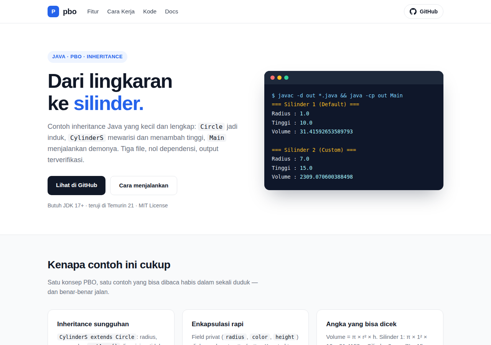

# pbo — latihan inheritance java

tugas kuliah pemrograman berorientasi objek (PBO): satu contoh inheritance yang
kecil dan lengkap. `Circle` adalah lingkaran (jari-jari + warna), `CylinderS`
adalah silinder yang **mewarisi** `Circle` dan menambah tinggi, lalu `Main`
menjalankan dua contoh silinder dan mencetak volumenya.



> video demo (tanpa suara, direkam headless): [docs/demo.mp4](docs/demo.mp4)
> halaman dokumentasi live: https://pbo-java.pages.dev

## cara menjalankan

butuh JDK 17 ke atas (teruji di Temurin 21.0.13).

```bash
javac -d out Circle.java CylinderS.java Main.java
java -cp out Main
```

atau sekali jalan:

```bash
./run.sh
```

## contoh output (asli, dari `java -cp out Main`)

```
=== Silinder 1 (Default) ===
Radius : 1.0
Tinggi : 10.0
Volume : 31.41592653589793

=== Silinder 2 (Custom) ===
Radius : 7.0
Tinggi : 15.0
Volume : 2309.070600388498
```

angka di atas bisa dicek sendiri: volume = luas alas × tinggi =
π × r² × h. silinder 1: π × 1² × 10 = 31,4159…; silinder 2:
π × 7² × 15 = 2309,0706…

## kelas-kelasnya

| kelas | peran | field | method kunci |
|---|---|---|---|
| `Circle` | kelas induk: lingkaran | `radius`, `color` | `getArea()` → π × r² |
| `CylinderS extends Circle` | kelas anak: silinder | + `height` | `getVolume()` → `getArea()` × tinggi |
| `Main` | demo | — | `main()` — dua silinder, cetak volume |

diagram lengkap: [docs/class-diagram.html](docs/class-diagram.html) ·
arsitektur: [docs/architecture.md](docs/architecture.md) ·
panduan pakai: [docs/usage.md](docs/usage.md)

## struktur proyek

```
Circle.java        # lingkaran: radius, warna, luas
CylinderS.java     # silinder: mewarisi Circle + tinggi + volume
Main.java          # demo dua silinder
run.sh             # compile + jalankan sekali jalan
.github/workflows/ci.yml   # CI: javac + run + verifikasi output
docs/              # arsitektur, diagram kelas, panduan
site/              # landing page dokumentasi (deploy ke Cloudflare Pages)
```

file `.class` hasil compile **tidak** di-commit — hasil compile masuk `out/`
yang sudah di-`.gitignore`. kalau di komputermu muncul `*.class` setelah
compile, itu normal dan tidak akan ikut ke repo.

## yang berubah di v1.1.0

- **bug diperbaiki:** ada huruf `z` nyasar di `Circle.java` (baris 10) yang
  bikin `javac` gagal — sudah dihapus, program sekarang compile & jalan.
- file `.class` yang dulu ke-commit sudah dihapus dari tree, `.gitignore`
  diperkuat (`*.class`, `out/`, IDE).
- README & PRD lama (template fiktif — klaim "Static Web" + `npm install`)
  ditulis ulang sesuai isi repo yang sebenarnya.
- CI baru: compile + jalankan demo + verifikasi angka volumenya.
- docs lengkap + landing page dokumentasi.

## lisensi

MIT — lihat [LICENSE](./LICENSE).
